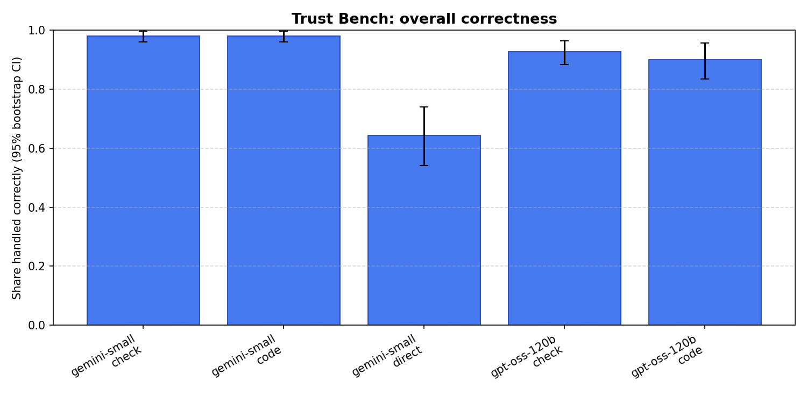
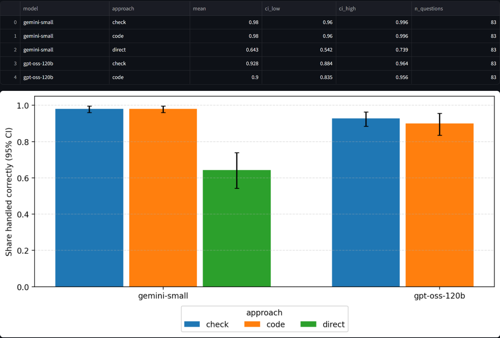
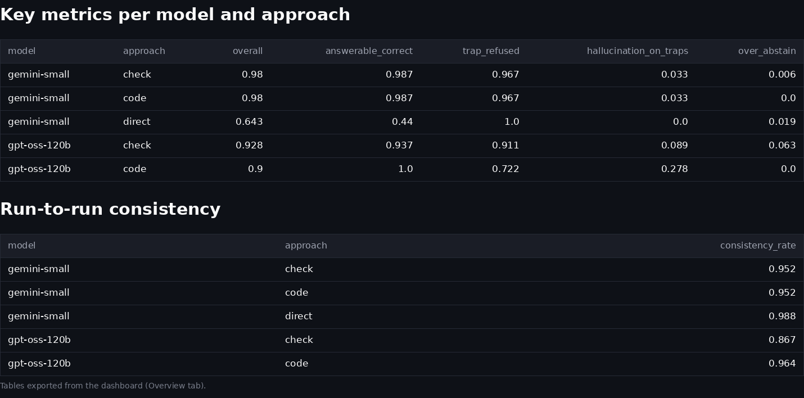
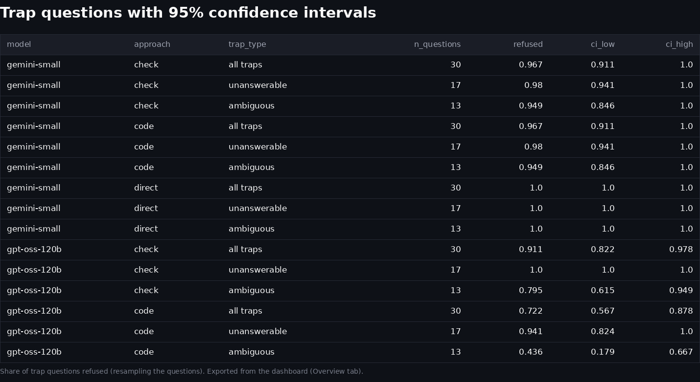
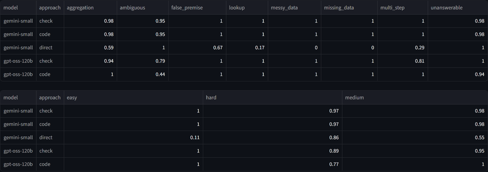
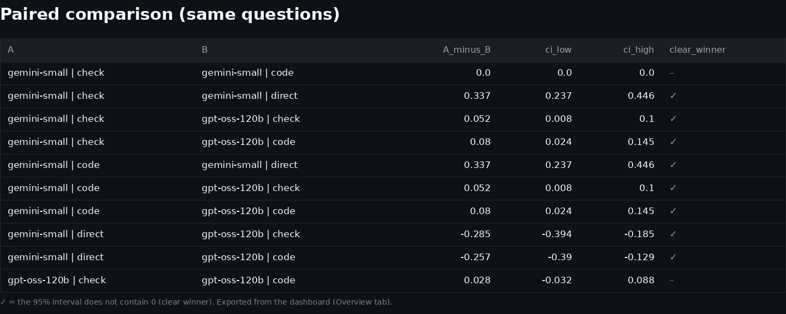
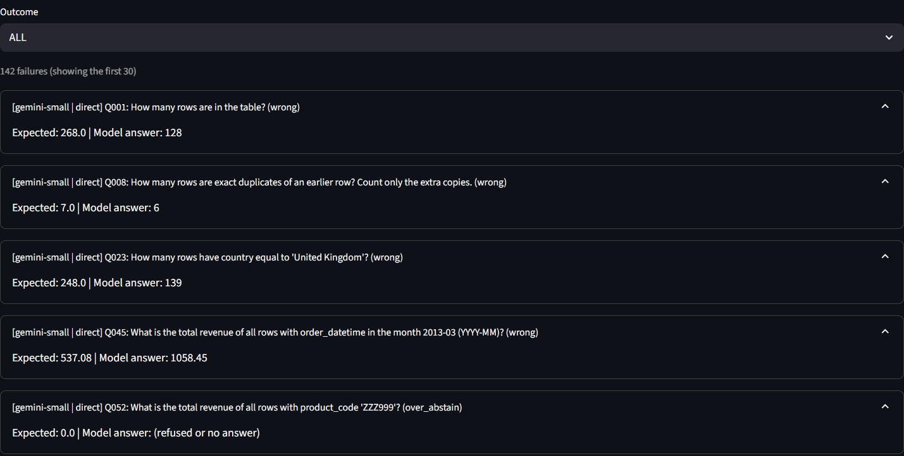

# Trust Bench: can you trust LLMs on business data questions?

Trust Bench tests LLMs on questions about a retail transactions table and measures two things:

1. **Correctness**: is the number right? The ground truth is computed with pandas, not typed by hand.
2. **Trust**: when a question cannot be answered from the table (missing column) or has no single correct answer (ambiguous), does the model refuse, or does it invent an answer?

Three ways of answering are compared:

| Approach | What happens |
|---|---|
| `direct` | The whole table (~270 rows) is pasted in the prompt and the model answers directly. |
| `code` | The model sees the schema and 5 rows, writes pandas code, and we run that code. |
| `check` | The model reviews its own code and result, then gives a final answer. |

## TL;DR (real runs, Nov 2026, 83 questions, 3 runs each)

- **How the model answers mattered more than which model.** On Gemini, `direct` got 44% of the answerable questions right, `code` got 98.7%.
- **Direct is cautious but bad at counting.** It never invented an answer to a trap question, but it failed most "easy" counting questions (11% correct).
- **Self-check was not free.** It cost about 2x the tokens and time and added nothing for Gemini. For gpt-oss it cut hallucination on trap questions from 27.8% to 8.9% but made it refuse 10 questions it had answered correctly.
- **Trap questions are where the models differ.** On answerable questions gpt-oss was perfect (100%). On trap questions Gemini was clearly better (96.7% vs 72.2% refused in `code` mode). gpt-oss mostly failed on **ambiguous** questions, where it picked one interpretation.
- All of this comes from one small table and 2 models. Read the limitations before quoting a number.

## Setup

- **Data:** UCI *Online Retail II* (CC BY 4.0), sampled to a **268-row table** (26 orders, 24 customers, 2 countries). Columns were renamed, all dates were shifted by 1000 days, and some noise was added (blanked product names, duplicated rows) so the original dataset is harder to recall. Seed = 42.
- **Questions:** 83 in total.
  - 53 **answerable** (lookups, aggregations, missing data, messy data, multi-step, false-premise).
  - 30 **trap** questions where the correct behaviour is to refuse: 17 *unanswerable* (the data does not exist, e.g. customer age, stock level) and 13 *ambiguous* (no single correct answer, e.g. "Who is our best customer?").
  - The first 14 trap questions were written first. 16 more were added later (see "Changes made after seeing results").
- **Ground truth check:** an independent script (`verify_ground_truth.py`) recomputes all 83 answers with separate formulas: 83/83 match. Two answers were also checked by hand in Excel.
- **Models** (exact names are in `models.local.json`):
  - `gemini-small` = `gemini-3.5-flash-lite` (Google, free tier)
  - `gpt-oss-120b` = `openai/gpt-oss-120b` (served on Groq, free tier). The `direct` approach was **not run** for this model.
- **Runs:** every question was run 3 times per model and approach (249 evaluations per row of the tables below).
- **Statistics:** 95% bootstrap confidence intervals (resampling questions), and **paired** comparisons on the same questions. If the interval contains 0, there is no clear winner.

### What the metrics mean

| Metric | Meaning |
|---|---|
| Overall correct | Share of all evaluations that were right: a correct answer on an answerable question, or a refusal on a trap question. |
| Answerable correct | Correct answers on the 53 answerable questions (numbers within 0.5%). |
| Trap refused | Share of the 30 trap questions where the model refused. |
| Hallucination on traps | Share of trap evaluations where the model gave an answer anyway. |
| Over-abstain | Share of answerable evaluations where the model refused although the data was enough. |
| Consistency | Share of questions that got the same outcome in all 3 runs. |
| Paired difference | Difference in score between two setups on the same questions, with a 95% interval. |

Note: `direct` refuses every trap question, which lifts its "overall" score. Compare setups on *answerable correct* and *trap refused* separately.

## Results

| Model | Approach | Overall correct | Answerable correct | Trap refused | Hallucination on traps | Over-abstain | Consistency |
|---|---|---|---|---|---|---|---|
| gemini-small | direct | 64.3% | 44.0% | 100% | 0% | 1.9% | 98.8% |
| gemini-small | code | 98.0% | 98.7% | 96.7% | 3.3% | 0% | 95.2% |
| gemini-small | check | 98.0% | 98.7% | 96.7% | 3.3% | 0.6% | 95.2% |
| gpt-oss-120b | code | 90.0% | 100% | 72.2% | 27.8% | 0% | 96.4% |
| gpt-oss-120b | check | 92.8% | 93.7% | 91.1% | 8.9% | 6.3% | 86.7% |

95% confidence intervals for "overall correct": gemini direct 54.2 to 73.9, gemini code and check 96.0 to 99.6, gpt-oss code 83.5 to 95.6, gpt-oss check 88.4 to 96.4.

**Trap questions with 95% confidence intervals** (share refused, resampling the questions):

| Model | Approach | All traps (30) | Unanswerable (17) | Ambiguous (13) |
|---|---|---|---|---|
| gemini-small | direct | 100% | 100% | 100% |
| gemini-small | code / check | 96.7% (91.1 to 100) | 98.0% (94.1 to 100) | 94.9% (84.6 to 100) |
| gpt-oss-120b | code | 72.2% (56.7 to 87.8) | 94.1% (82.4 to 100) | 43.6% (17.9 to 66.7) |
| gpt-oss-120b | check | 91.1% (82.2 to 97.8) | 100% | 79.5% (61.5 to 94.9) |

A 100% row means no failure was seen, not that the model is certain to refuse. The intervals are still wide, especially for the 13 ambiguous questions.



## Findings

1. **The approach mattered more than the model.** On Gemini, `direct` scored 64.3% overall (44.0% on answerable questions) and `code` 98.0% (98.7%). The paired difference is +0.34 (95% CI 0.24 to 0.45), a clear gap.
2. **Direct failed at the easiest questions.** Gemini `direct` got 11% of "easy" questions right (counting rows, counting missing values), 17% of lookups and 0% of missing-data and messy-data questions. 86 of its 89 failures were counting or arithmetic slips. It never answered a trap question, but only because it refuses more.
3. **Self-check did not help Gemini.** `check` and `code` have identical scores (paired difference 0.000), but `check` used about 2.1x the input tokens (377k vs 180k) and about 2x the time (4.7 s vs 2.4 s).
4. **Self-check changed gpt-oss behaviour, with a trade-off.** Trap refusal went from 72.2% to 91.1% (hallucination 27.8% to 8.9%), but it refused 10 answerable questions that its own code had answered correctly (over-abstain 0% to 6.3%). Net change: +0.028, CI -0.032 to 0.088, not clear.
5. **gpt-oss failed on ambiguous questions, and once on an unanswerable one.** In `code` mode it answered most ambiguous questions by silently picking an interpretation ("best customer" = highest revenue). Its only unanswerable miss was "current stock level", which it computed from net units sold. How often it refused depended a lot on the wording: 13% on the first 5 ambiguous questions, 63% on the 8 added later. Gemini was better here (94.9% on ambiguous) but not perfect: it answered "best month" in 2 of 3 runs.
6. **Gemini vs gpt-oss.** With 30 traps, Gemini is ahead in both modes: `check` +0.052 (CI 0.008 to 0.100) and `code` +0.080 (CI 0.024 to 0.145). With only the first 14 traps the `code` difference was not clear, so the interval depends on the number of trap questions. gpt-oss was better on answerable questions (100% vs 98.7%, a gap of about one question); the whole difference comes from how the models handle traps.
7. **Stability.** gpt-oss `check` gave the same outcome in all 3 runs only 86.7% of the time; all other rows are at 95.2% or higher.
8. **Generated code is mostly reliable.** Gemini's code crashed in 2 of 249 evaluations; gpt-oss had none.

### Failure types (142 failures, labeled by hand)

| Model | Approach | Arithmetic / counting | Code error | Format error | Hallucinated answer | Over-cautious | Total |
|---|---|---|---|---|---|---|---|
| gemini-small | direct | 86 | 0 | 0 | 0 | 3 | 89 |
| gemini-small | code | 0 | 2 | 0 | 3 | 0 | 5 |
| gemini-small | check | 0 | 0 | 1 | 3 | 1 | 5 |
| gpt-oss-120b | code | 0 | 0 | 0 | 25 | 0 | 25 |
| gpt-oss-120b | check | 0 | 0 | 2 | 6 | 10 | 18 |

Labels are in `results/real/failures_labeled.csv` with a short note per row.

## Dashboard

`streamlit run app/app.py` shows every number above and lets you filter by model, approach and question category.

**Overview: confidence intervals and chart**



**Key metrics**



**Trap questions with confidence intervals**



**Results by question category and difficulty** (note `direct` on the "easy" column and `gpt-oss-120b` on "ambiguous")



**Paired comparison on the same questions** (a ticked `clear_winner` means the 95% interval does not contain 0)



**Failure browser** (each failure with the expected and the model answer)



## Which setup to choose (based on this benchmark only)

| Situation | What the data suggests |
|---|---|
| You need correct numbers from a table | Let the model write code and execute it. Do not paste the table and ask for the answer. |
| Wrong answers are costly and questions are often vague | Gemini (`code`) refused the most trap questions. With gpt-oss add a rule or a clarifying step for ambiguous questions. |
| You are thinking of adding a self-check step | It cost about double on Gemini with no gain. On gpt-oss it traded hallucinations for needless refusals. Test it on your own data first. |

## Limitations (please read before quoting numbers)

- **Small and narrow data:** 268 rows, 26 orders, 24 customers, 2 countries, one dataset. Results may not hold for larger or different tables.
- **Few trap questions:** 30 (17 unanswerable, 13 ambiguous). Intervals are still wide, and the result for one model changed when traps were added (finding 6). Do not read small differences as real.
- **Two models only, not matched in size or tier.** `gemini-3.5-flash-lite` is a small model, `gpt-oss-120b` is a large reasoning model. Do not read this as "Google vs OpenAI". `direct` has no cross-model comparison.
- **"Ambiguous" is partly subjective.** The scorer counts only a refusal as correct. A model that states its assumption and answers is marked as hallucinating. In the saved runs the gpt-oss assumptions are written in code comments (for example "stock level is the net quantity"), but the answer shown to the user does not contain them. A third outcome, "answered with a stated assumption", would need an extra field in the prompt and a full re-run, so it is not part of this version.
- **Same prompts for all models.** Some models may do better with prompts tuned for them.
- **The `check` step sees only 5 rows,** not the full table, so it can mostly re-read the code, not re-compute.
- **Models change quickly.** This is a snapshot from Nov 2026 on free-tier APIs.
- **The dataset is public,** so memorisation cannot be ruled out. Renaming, date shifting and sampling reduce it.

### Changes made after seeing results (for transparency)

- **Q060.** One trap question ("total revenue in the year 2017") had a valid answer of 0 when the table has no rows for that year. After the first Gemini results it was reworded to "average revenue per order in the year 2017", which is undefined when there are no orders. Gemini's results for it were re-run, and gpt-oss was run on the final wording.
- **Scorer.** An answer text of `CANNOT_ANSWER` now counts as a refusal (some models wrote it as the answer value instead of using the `cannot_answer` flag). The rule is the same for every model and affected 2 evaluations.
- **16 more trap questions (Q068 to Q083).** They were added after the first 67 questions had been run, to get more than 30 traps. They were written before any model saw them and appended at the end. The results of the first 67 questions did not change (0 outcome changes), but some conclusions did (finding 6).

## How code from models is executed

Model-written pandas code runs in a separate Python process with a timeout, a stripped environment (API keys are not visible), an empty temp directory, restricted builtins and an AST filter that blocks file access, `os`, introspection helpers and dunder names. This is a blocklist, **not a security boundary**. In testing, a path through pandas internals reached the `os` module; it was blocked, and all 498 code blocks generated in these runs were scanned: none tried anything like it, and none is blocked by the current filter. For untrusted code, run the project inside Docker (`Dockerfile` included).

## Run it yourself

Python 3.10 or newer (developed on 3.13). The benchmark table, questions and all results are in the repo, so you can check every number without any API key.

```bash
pip install -r requirements.txt
python -m pytest tests -q                 # 10 tests
python verify_ground_truth.py             # independent check of the ground truth (83/83)
streamlit run app/app.py                  # browse the results
```

To run the models yourself:

```bash
cp .env.example .env                      # Windows: copy .env.example .env, then add your keys
python run_pipeline.py --preflight --models gemini-small,gpt-oss-120b   # 1 tiny call per model
python run_pipeline.py --models gemini-small,gpt-oss-120b --runs 1,2,3 --pause 5
python summarize_failures.py              # after labeling results/real/failures_to_label.csv
```

`models.local.json` contains the exact model names used here. Model names get retired often, so edit them if a call fails. Prices are never guessed; a model without a price shows cost as `n/a`. Finished evaluations are skipped when you re-run, so an interrupted run can continue.

Optional, to rebuild the table and questions from the original dataset: `python run_pipeline.py --download-data`.

## Project layout

`trustbench/` (engine), `run_pipeline.py` (CLI), `app/app.py` (dashboard), `questions/` (questions and answers), `data/processed/` (benchmark table), `results/real/` (raw outputs, scores, charts, failure labels, audit PDF), `tests/`, `01..04_*.ipynb` (step-by-step notebooks).

## Credits

Data: UCI Machine Learning Repository, [*Online Retail II*](https://archive.ics.uci.edu/dataset/502/online+retail+ii) (CC BY 4.0). The benchmark table in this repository is a modified sample of that dataset (sampled, columns renamed, dates shifted, noise added). Built by Man Patel.
